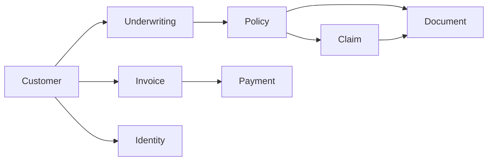

# BFSI Insurance ERP — full project

Internal staff system for an insurance carrier. A person is underwritten, a policy is bound, premiums are invoiced, and claims are adjusted against active cover.

This is an operations desk, not a policyholder portal. Staff sign in. Customers do not.

Open the HTML desk at [http://127.0.0.1:8000/](http://127.0.0.1:8000/). The API docs stay at [http://127.0.0.1:8000/api/docs/](http://127.0.0.1:8000/api/docs/).

## Business flow



1. **Customer** — the policyholder and the billing contact.
2. **Underwriting** — the risk decision. A policy may point at this request only after it is approved.
3. **Policy** — the contract of cover. It starts as draft, is quoted, then becomes active. Claims can be opened only on an active policy.
4. **Claim** — a loss on that policy. Status moves forward only. Each save runs fraud rules. Flags explain risk. They do not auto-reject the claim.
5. **Finance** — invoices and cash. Outstanding balance is open invoices, minus payments, plus refunds.
6. **Compliance** — the controls the carrier says it follows, and the reports filed against them.
7. **Documents** — files attached to a policy, claim, or underwriting request.
8. **Identity** — a mock KYC check. It stands in for a vendor such as Onfido or Jumio and does not call one.

## Desks

| Role | Username | Password | Can change | Can read |
|---|---|---|---|---|
| Admin | `admin` | `OpsLead123!` | Everything, including roles, finance, and compliance | Everything |
| Underwriter | `underwriter` | `RiskDesk123!` | Customers, underwriting, policies, documents, identity checks | Everything except the staff directory |
| Claims adjuster | `adjuster` | `ClaimsDesk123!` | Customers, claims, documents | Everything except the staff directory |

Finance and compliance records are written by admins. Other desks can read them.

The first account created through `POST /api/auth/register/` becomes admin. Later registrations cannot self-assign admin. An admin can change a role at `PATCH /api/auth/users/{id}/`.

## Sample book

`python manage.py seed_demo` loads two customers. `--reset` wipes that book and loads it again.

**Asha Rao** — approved health underwriting, an active health policy, a normal claim in review, a second claim that trips every fraud rule, an issued premium invoice with a part payment (outstanding **10000.00**), a verified passport, and a policy PDF.

**Rohan Mehta** — a motor underwriting request still submitted, a draft motor policy, and an overdue invoice (outstanding **8400.00**).

## Tech stack

| Layer | Choice |
|---|---|
| API | Django and Django REST Framework |
| Database | SQLite by default. PostgreSQL when `POSTGRES_HOST` is set |
| Auth | JWT (`djangorestframework-simplejwt`) |
| Docs | drf-spectacular at `/api/docs/` |
| Filters | django-filter, search, ordering, page number pagination (20 per page, `page_size` up to 100) |
| Desk UI | HTML, CSS, and one JavaScript file in `portal/` |
| Tests | pytest and pytest-django |
| Containers | Docker Compose: Postgres 16 and the web app |

## Repository map

```
bfsi_erp/
├── config/                 settings, root URLs, Swagger
├── core/                   staff user, timestamps, roles, pagination, seed command
├── customers/              policyholders
├── underwriting/           risk decisions
├── policies/               contracts of cover
├── claims/                 losses and fraud rules
├── finance/                invoices, transactions, outstanding balance
├── compliance/             rules and reports
├── documents/              file upload and download
├── identity/               mock KYC
├── portal/                 HTML desk (templates, CSS, JS)
├── tests/                  API tests
├── postman/                Postman collection
├── docker-compose.yml
├── requirements.txt
└── manage.py
```

Every domain app has `models.py`, `serializers.py`, `views.py`, `urls.py`, and `admin.py`. Shared timestamps live on `TimeStampedModel` in `core/models.py` (`created_at`, `updated_at`). Reference numbers such as `POL-20260927-559D8D` are generated on save.

Deleting a customer, policy, or claim that other records still point at returns **409**. The database uses `PROTECT` on those links.

## Data model

| Model | Important fields | Relations |
|---|---|---|
| User | username, email, password, role | staff account |
| Customer | name, email, phone, address | — |
| UnderwritingRequest | policy_type, details, status | customer |
| Policy | policy_number, type, start_date, end_date, premium_amount, status | customer, optional approved underwriting request |
| Claim | claim_number, claimant_name, claim_date, description, amount, status, fraud_flagged, fraud_flags | policy |
| Invoice | invoice_number, amount, due_date, status | customer, optional policy |
| Transaction | transaction_number, type, amount, date, description | optional customer, optional invoice |
| ComplianceRule | name, description, status | — |
| ComplianceReport | report_number, report_date, status, details | optional rule |
| Document | name, type, size, file, url | policy and/or claim and/or underwriting request |
| IdentityVerificationRequest | document_type, document_number, status, provider, result_detail | customer |

Cover types, used by policies and underwriting: `life`, `health`, `motor`, `property`, `travel`.

Money fields must be greater than zero. A policy end date must be after the start date. A claim date cannot be in the future.

## Status rules

The API enforces these moves. The seed writes finished states directly so the desk has something to show immediately.

**Underwriting:** submitted → in review → approved, declined, or referred. From referred it can go back to in review, or to approved or declined. Approved and declined stop.

**Policy:** draft → quoted → active → lapsed, cancelled, or expired. A lapsed policy can become active again. Cancelled and expired stop.

**Claim:** intake → under review → approved → settled. Intake or under review can also be rejected. Settled and rejected stop. A claim cannot jump from intake to settled.

**Invoice:** draft → issued → paid, overdue, or void. A draft can also be voided. Overdue can still be paid or voided. Paid and void stop.

**Compliance rule:** active ↔ inactive.

**Compliance report:** draft → submitted → accepted or rejected.

## Fraud rules

Recalculated in `claims/fraud.py` every time a claim is saved.

| Flag | Meaning |
|---|---|
| `amount_exceeds_threshold` | Amount is 100,000 or more |
| `claimant_name_mismatch` | Claimant name differs from the policyholder |
| `claim_outside_policy_period` | Loss date is outside the policy start and end |
| `duplicate_open_claim` | Another claim on the same policy is still intake, under review, or approved |

List flagged claims with `GET /api/claims/?fraud_flagged=true`.

## Finance formula

`outstanding balance = open invoices − payments + refunds`

Open invoices are those with status `issued` or `overdue`. Paid and void invoices are excluded. Premium, claim-payout, and adjustment transactions are stored and do not change this number, because the invoice is already the amount billed.

`GET /api/finance/customers/{id}/outstanding-balance/`

A payment or refund must name the customer. If you send an invoice and omit the customer, the customer is copied from the invoice. The policy on an invoice must belong to that customer.

## Identity mock

`POST /api/identity/verify/` with `customer`, `document_type` (`passport`, `drivers_license`, `national_id`), and `document_number`.

| Input | Result |
|---|---|
| Number ends with `X` | failed — mock provider rejected it |
| Shorter than 6 characters, or not alphanumeric | failed — format check |
| Passport or national ID with a normal number | verified |
| Driver's license with a normal number | manual review |

`provider` is always `mock`. History is `GET /api/identity/verifications/`.

## Documents

Upload with `multipart/form-data` to `POST /api/documents/`. Allowed types: PDF, Word (`.doc`, `.docx`), PNG, JPEG. Limit is 5 MB (`MAX_UPLOAD_BYTES`).

| `type` | Required link |
|---|---|
| policy | `policy` |
| claim | `claim` |
| underwriting | `underwriting_request` |
| identity, other | no link required |

If both a claim and a policy are set, the claim must belong to that policy. Download with `GET /api/documents/{id}/download/`. Files are stored under `media/`.

## API

All business routes require `Authorization: Bearer <access>`. Login and the docs do not.

| Method | Path | Purpose |
|---|---|---|
| POST | `/api/auth/register/` | Create a staff user. Returns tokens |
| POST | `/api/auth/login/` | Returns `access`, `refresh`, `role`, `username` |
| POST | `/api/auth/refresh/` | New access token |
| GET | `/api/auth/me/` | Current user |
| GET, PATCH | `/api/auth/users/` | Admin staff directory |
| GET, POST | `/api/customers/` | List and create |
| GET, PUT, PATCH, DELETE | `/api/customers/{id}/` | One customer |
| GET, POST | `/api/underwriting/` | List and create. New records start as `submitted` |
| GET, PUT, PATCH, DELETE | `/api/underwriting/{id}/` | One request |
| GET, POST | `/api/policies/` | List and create. New records start as `draft` |
| GET, PUT, PATCH, DELETE | `/api/policies/{id}/` | One policy |
| GET, POST | `/api/claims/` | List and create. New records start as `intake` |
| GET, PUT, PATCH, DELETE | `/api/claims/{id}/` | One claim |
| GET, POST | `/api/finance/invoices/` | List and create. New records start as `draft` |
| GET, PUT, PATCH, DELETE | `/api/finance/invoices/{id}/` | One invoice |
| GET, POST | `/api/finance/transactions/` | List and create |
| GET, PUT, PATCH, DELETE | `/api/finance/transactions/{id}/` | One transaction |
| GET | `/api/finance/customers/{id}/outstanding-balance/` | Computed balance |
| GET, POST | `/api/compliance/rules/` | List and create |
| GET, PUT, PATCH, DELETE | `/api/compliance/rules/{id}/` | One rule |
| GET, POST | `/api/compliance/reports/` | List and create. New records start as `draft` |
| GET, PUT, PATCH, DELETE | `/api/compliance/reports/{id}/` | One report |
| GET, POST | `/api/documents/` | List and upload |
| GET, PUT, PATCH, DELETE | `/api/documents/{id}/` | One document |
| GET | `/api/documents/{id}/download/` | File bytes |
| POST | `/api/identity/verify/` | Run the mock check |
| GET | `/api/identity/verifications/` | Past checks |
| GET | `/api/` | Module map as JSON |
| GET | `/api/schema/` | OpenAPI schema |
| GET | `/api/docs/` | Swagger UI |

List routes accept `search`, `ordering`, `page`, and `page_size`. Useful filters: `status`, `customer`, `type`, `fraud_flagged`, `policy`.

Change a status with PATCH, for example `{ "status": "quoted" }`. An illegal move returns 400 and names the allowed next statuses.

## HTML desk

`portal/templates/portal/index.html`, `portal/static/portal/app.css`, and `portal/static/portal/app.js`.

The page is one screen. JavaScript calls the API with the JWT stored in `sessionStorage`. The sidebar switches between Overview, Customers, Underwriting, Policies, Claims, Finance, Compliance, Documents, and Identity. Overview shows counts and each customer's outstanding balance. Status dropdowns PATCH the record. A failed move shows the API error and puts the dropdown back.

The Admin, Underwriter, and Adjuster buttons on the sign-in card fill the demo accounts and sign in.

## Run locally

```powershell
python -m venv .venv
.\.venv\Scripts\Activate.ps1
pip install -r requirements.txt
python manage.py migrate
python manage.py seed_demo
python manage.py runserver
```

SQLite file: `db.sqlite3`. No Postgres is required for local use.

### Docker

```powershell
docker compose up --build
```

Compose sets `POSTGRES_HOST=db`, so the app uses PostgreSQL instead of SQLite. Copy `.env.example` to `.env` to override the secret key, debug flag, or database name. The default secret is for local development only.

### Tests

```powershell
pytest
```

GitHub Actions (`.github/workflows/ci.yml`) runs the same suite on Python 3.12. Postman collection: `postman/bfsi_erp.postman_collection.json`. The Login request stores the access token on the collection.

### Example calls

```powershell
$base = "http://127.0.0.1:8000"
$login = Invoke-RestMethod -Method Post -Uri "$base/api/auth/login/" -ContentType "application/json" -Body '{"username":"admin","password":"OpsLead123!"}'
$headers = @{ Authorization = "Bearer $($login.access)" }

Invoke-RestMethod -Uri "$base/api/customers/?search=Asha" -Headers $headers
Invoke-RestMethod -Uri "$base/api/claims/?fraud_flagged=true" -Headers $headers
Invoke-RestMethod -Uri "$base/api/finance/customers/1/outstanding-balance/" -Headers $headers
```

## What is intentionally mocked

Identity verification does not call an outside provider. Document storage is the local `media/` folder, not S3. Fraud checks are four rules, not a model. The seed skips the status path and writes final states. The API itself does not.
