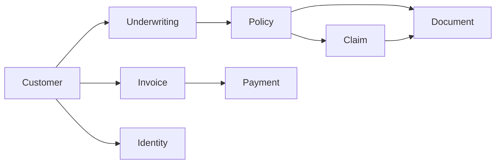

# BFSI Insurance ERP

Staff API for an insurance carrier. It follows one book of business from the person, through underwriting and the policy, into billing and claims.

This is an internal operations system. It is not a policyholder self-service portal. Every business endpoint requires a logged-in staff user.

## The business flow



1. A **customer** is the policyholder and the billing contact.
2. **Underwriting** decides whether that person can be covered. A policy can point at an underwriting request only after it is approved.
3. A **policy** starts as `draft`, is `quoted`, then becomes `active`. Claims can be opened only against an active policy.
4. A **claim** moves `intake` → `under_review` → `approved` → `settled`. Rejected and settled claims do not move backward. Each save runs rules-based fraud checks.
5. **Finance** bills the customer. Outstanding balance is open invoices, minus payments, plus refunds.
6. **Compliance** stores the controls the carrier says it follows, and the reports filed against them.
7. **Documents** are files attached to a policy, claim, or underwriting request.
8. **Identity** is a mock KYC check. It stands in for a vendor such as Onfido or Jumio and does not call one.

## Desks

| Role | Can change | Can read |
|---|---|---|
| Admin | Everything, including roles and finance | Everything |
| Underwriter | Customers, underwriting, policies, documents, identity checks | Everything |
| Claims adjuster | Customers, claims, documents | Everything except the staff directory |

Finance and compliance records are written by admins. Other desks can read them.

The first account created through `/api/auth/register/` becomes admin. Later registrations cannot self-assign admin.

## Status rules

These are enforced by the API. The demo seed writes finished states directly so there is something to look at immediately.

**Policy:** draft → quoted → active → lapsed, cancelled, or expired. A lapsed policy can be made active again. Cancelled and expired stop.

**Underwriting:** submitted → in review → approved, declined, or referred. Approved and declined stop.

**Claim:** intake → under review → approved → settled. Intake or review can also be rejected. Settled and rejected stop.

**Invoice:** draft → issued → paid, overdue, or void. Overdue can still be paid or voided.

**Compliance report:** draft → submitted → accepted or rejected.

**Fraud flags** on a claim (recalculated on every save):

- `amount_exceeds_threshold` — amount is 100,000 or more
- `claimant_name_mismatch` — claimant name differs from the policyholder
- `claim_outside_policy_period` — loss date is outside the policy dates
- `duplicate_open_claim` — another open claim already exists on that policy

Flags are explanations for an adjuster. They do not auto-reject the claim.

**Identity mock:** a document number ending in `X` fails. A number shorter than 6 characters, or one that is not alphanumeric, fails format checks. A normal passport or national ID is verified. A driver's license goes to manual review.

**Outstanding balance** for a customer:

`open invoices (issued or overdue) − payments + refunds`

Paid and void invoices are excluded. Premium, claim-payout, and adjustment transactions are stored and do not change this number, because the invoice is already the amount billed.

## Run it locally

SQLite is the default, so Postgres is optional.

```powershell
python -m venv .venv
.\.venv\Scripts\Activate.ps1
pip install -r requirements.txt
python manage.py migrate
python manage.py seed_demo
python manage.py runserver
```

Open [http://127.0.0.1:8000/](http://127.0.0.1:8000/) for the HTML desk. Swagger stays at [http://127.0.0.1:8000/api/docs/](http://127.0.0.1:8000/api/docs/). [http://127.0.0.1:8000/api/](http://127.0.0.1:8000/api/) lists the modules. Django admin is at [http://127.0.0.1:8000/admin/](http://127.0.0.1:8000/admin/).

Reload the sample book with `python manage.py seed_demo --reset`.

### Sample logins

| Username | Password | Role |
|---|---|---|
| admin | OpsLead123! | Admin |
| underwriter | RiskDesk123! | Underwriter |
| adjuster | ClaimsDesk123! | Claims adjuster |

The seed creates two customers:

- **Asha Rao** — approved health underwriting, an active policy, a normal claim in review, a second claim that trips the fraud rules, an issued premium invoice with a part payment, a verified passport, and a policy PDF.
- **Rohan Mehta** — a motor underwriting request still submitted, a draft policy, and an overdue invoice.

### Postgres with Docker

```powershell
docker compose up --build
```

That starts Postgres and the API on port 8000. Set `POSTGRES_HOST` (Compose does this) to leave SQLite. Copy `.env.example` to `.env` if you want the variables locally.

## Call the API

```powershell
$base = "http://127.0.0.1:8000"
$login = Invoke-RestMethod -Method Post -Uri "$base/api/auth/login/" -ContentType "application/json" -Body '{"username":"admin","password":"OpsLead123!"}'
$headers = @{ Authorization = "Bearer $($login.access)" }

Invoke-RestMethod -Uri "$base/api/customers/?search=Asha" -Headers $headers
Invoke-RestMethod -Uri "$base/api/claims/?fraud_flagged=true" -Headers $headers
Invoke-RestMethod -Uri "$base/api/finance/customers/1/outstanding-balance/" -Headers $headers
```

List endpoints accept `search`, `ordering`, `page`, and `page_size`, plus the filters named in Swagger (for example `status`, `customer`, `fraud_flagged`).

A Postman collection lives in `postman/bfsi_erp.postman_collection.json`. The login request saves the access token onto the collection.

## Tests

```powershell
pytest
```

GitHub Actions runs the same suite on Python 3.12.

## Layout

| Path | What it is |
|---|---|
| `config/` | Settings, root URLs, Swagger |
| `core/` | Staff user, timestamps, role permission, pagination |
| `customers/` | Policyholders |
| `underwriting/` | Risk decisions |
| `policies/` | Contracts of cover |
| `claims/` | Losses and fraud rules |
| `finance/` | Invoices, transactions, outstanding balance |
| `compliance/` | Rules and reports |
| `documents/` | Uploads linked to the record they belong to |
| `identity/` | Mock KYC |

Uploads are stored under `media/` (5 MB; PDF, Word, PNG, JPEG). Swap the file storage backend if you later want S3 or MinIO. Do not point identity at a real vendor without a contract and credentials kept out of this repo.
